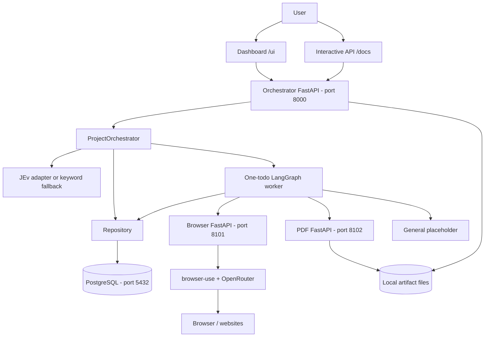
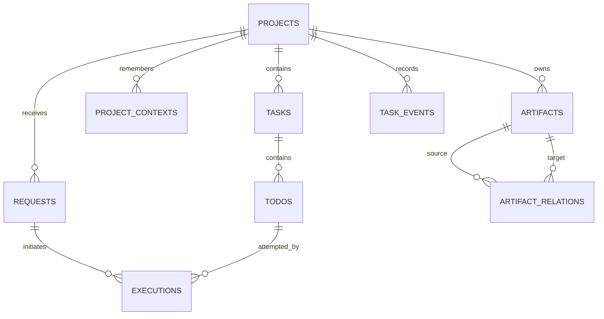
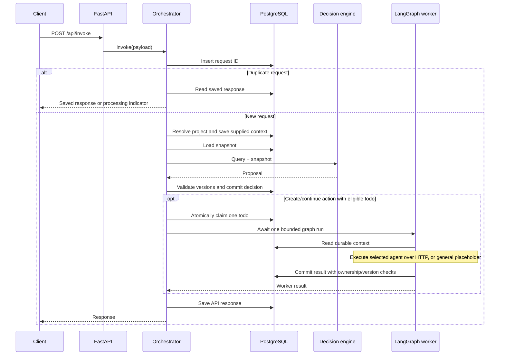
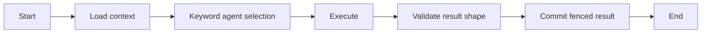
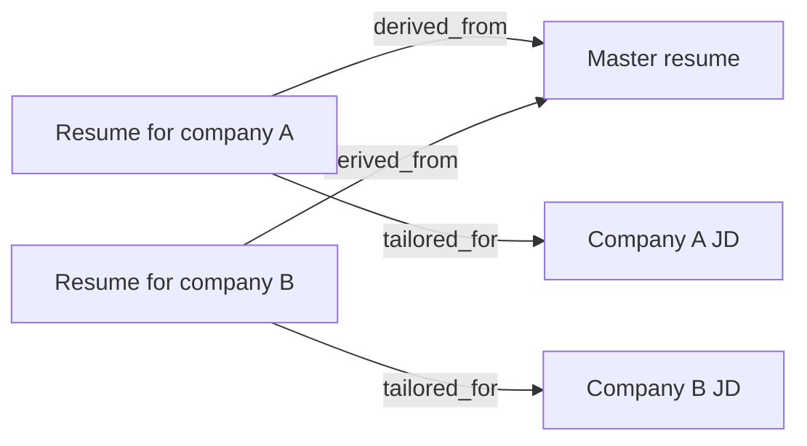

# Surake: current implementation architecture

_As implemented in the working tree on 21 October 2026._

This document explains **what the code currently does**, not just the intended design in [project_orchestrator_architecture.md](./project_orchestrator_architecture.md). The application is a local-development prototype with persistent project state, a dashboard, and two separate agent services. It is **not yet a complete autonomous project executor**.

## 1. System at a glance



| Component | Current responsibility | Source |
|---|---|---|
| Orchestrator API | Request validation, service wiring, project/context/artifact endpoints | [app.py](./src/surake/app/app.py) |
| Project orchestrator | Intake, project resolution, routing proposal, one work attempt, response | [orchestrator.py](./src/surake/app/services/orchestrator.py) |
| Decision layer | Suggest an existing task or a new task | [decision.py](./src/surake/app/services/decision.py) |
| Repository | SQL transactions, claims, state changes, context, artifact metadata, dashboard reads | [repository.py](./src/surake/app/db/repository.py) |
| Worker graph | Load context, choose an agent, execute, validate result shape, commit | [graph.py](./src/surake/app/workers/graph.py) |
| Browser service | Bounded browser-use run | [browser agent](./services/browser_agent/src/browser_agent/main.py) |
| PDF service | PDF rotation and merging | [PDF editor](./services/pdf_editor_agent/src/pdf_editor_agent/main.py) |
| Dashboard | Project creation, monitoring, memory editing, artifact uploads/downloads | [dashboard.html](./src/surake/app/ui/dashboard.html) |

The [Agent class](./src/surake/app/agent/agent.py) is a thin facade around the orchestrator, not a separate autonomous agent or memory store.

## 2. Startup and deployment

There are three independent Python FastAPI applications, normally run on the same machine. PostgreSQL runs separately. The current [Compose configuration](./compose.yaml) defines **only PostgreSQL**, not the API or agent servers.

When the orchestrator starts, it:

1. Loads application settings.
2. Opens an `asyncpg` connection pool and configures JSON/JSONB encoding.
3. Executes the schema initialization SQL.
4. Constructs the repository, worker graph, local artifact store, and decision engine.
5. Places these shared objects on FastAPI application state.

See [database initialization](./src/surake/app/db/pool.py) and [schema.sql](./src/surake/app/db/schema.sql). Schema setup uses `CREATE TABLE IF NOT EXISTS`; there is no versioned migration framework yet.

The [VS Code tasks](./.vscode/tasks.json) start the three servers. Startup instructions are in [README.md](./README.md).

### Configuration boundaries

- [Settings](./src/surake/app/core/config.py) reads application environment variables and a working-directory `.env` file.
- JEv and the browser service read provider credentials through `os.getenv`. Loading settings does **not** export `.env` values into the process environment. Provider keys must actually reach those processes; merely copying the example configuration is not sufficient for these code paths.
- Browser automation defaults to the configured OpenRouter model. Without its provider key, it returns `blocked`.
- The PDF service reads `PDF_ARTIFACT_ROOT` independently. It must point to the same physical storage as the orchestrator's `ARTIFACT_ROOT` if files are to be shared. Relative paths depend on the process working directory.
- Application data survives a server restart only if the PostgreSQL volume and local artifact directory are preserved. Back up **both**.

## 3. Core concepts and persistence

A **project** is the long-lived workspace, such as “Career switch.” A **task** is an objective within it. A **todo** is a bounded work item. An **execution** records one attempt at a todo. A **request** records one incoming query.



The diagram shows the main logical relationships; the SQL schema is authoritative for nullable references and constraints.

| Table | Stored information | Current use |
|---|---|---|
| `projects` | Owner, name, optional external key, project map, version, status | Canonical project identity |
| `tasks` | Objective, summary, priority, version, active execution, lease | Canonical task state |
| `todos` | Work description, dependencies, criteria, result, artifact references, version | Bounded units of work |
| `requests` | Query, owner, classification, saved response, status | Intake and duplicate-request handling |
| `executions` | Attempt, IDs, graph-thread label, fencing token, runtime timestamps/errors | Execution records |
| `task_events` | Event type, reason, payload, related IDs, time | Decision/result/context/artifact history |
| `query_task_impacts` | Request-to-task relationship | Records the impact of existing-task routing |
| `steering_requests` | Pending instruction for a task | Written, but not consumed by the worker |
| `outbox` | Task-ready notification payload | Written, but no dispatcher consumes it |
| `external_action_guards` | Intended external-action deduplication state | Table exists; not wired into execution |
| `project_contexts` | Key/value facts, preferences, category, importance, version | Durable cross-task memory |
| `artifacts` | File reference, name, kind, hash, size, metadata, optional task | Searchable file registry |
| `artifact_relations` | Directed links between artifacts | Resume lineage and JD targeting |

Identifiers are UUIDs except the outbox sequence and textual keys. `graph_thread_id` is recorded as `task:<task_id>`, but **is not currently a durable LangGraph checkpoint identifier in use**: the graph is compiled without a checkpointer.

## 4. What happens when a query arrives

The request enters through `POST /api/invoke` in [invoke.py](./src/surake/app/routes/invoke.py), using the [Pydantic contracts](./src/surake/app/models/domain.py).



Important details:

- The route returns HTTP **202**, but it **awaits the work inside the request**. It does not enqueue a background job and immediately return.
- Supply `project_id` for follow-up work. Without an explicit key, resolution reuses the owner's most recently updated active project, or creates one if none exists.
- The request body’s `request_id` is the idempotency key. The `Idempotency-Key` header is not implemented by the route.
- Reusing a saved request ID returns its saved response; the original query is not compared with a changed payload. Use the same ID only for retries of the same operation.
- On a repository version conflict, the orchestrator reloads/reclassifies once, for at most two attempts.
- A new task gets proposal todos, or a single todo containing the query. Initially only the first todo is ready.
- Continuing an existing task records its impact and attempts an existing ready todo. It does **not** automatically append a new todo for every follow-up query.
- After one todo finishes, other eligible todos may become ready, but there is no scheduling loop to execute them automatically.

## 5. Decision-making versus execution

### Decision engine

With `JEV_API_KEY` in the process environment, the code calls `TypeSafeClassifier(model="jev-1.13")`, then parses the result as a `DecisionProposal`. The adapter checks selected task IDs and task versions against the supplied snapshot; repository transactions also check versions before committing changes.

Without that key, routing is a **deterministic word-overlap heuristic**, not an LLM:

- Compare query words against task titles/descriptions.
- At least two matching words selects the best matching task.
- A matching in-progress task produces a steering request.
- Otherwise, create a new task with one todo.

The fallback does not reason over saved preferences. The JEv path includes context and artifact metadata in its input, but neither mode implements a dedicated job-ranking algorithm. A confidence field is present; a low-confidence clarification policy is not enforced.

The proposal schema names actions such as modification, informational answers, clarification, and new-project suggestions. Their complete business workflows are not all implemented. Schema support is not equivalent to end-to-end feature support.

### One-todo worker graph



Agent selection is currently keyword-based in [graph.py](./src/surake/app/workers/graph.py), not chosen dynamically by JEv:

| Match in todo description | Execution branch |
|---|---|
| `browse`, `website`, `web `, `url`, `search online` | Browser service |
| `pdf`, `document`, `form` | PDF service |
| Anything else | General placeholder |

**The general branch does no substantive work.** It returns `completed` with “Accepted bounded work item: …”. A completed task in the dashboard therefore does not necessarily mean its real-world objective has been achieved.

Remote agent calls have a 120-second HTTP timeout. Context is appended to the instruction as JSON. Result validation accepts `completed`, `blocked`, or `failed`; it does not independently verify acceptance criteria, file contents, or real-world success. The orchestrator supplies the execution IDs/fencing token around the remote result rather than requiring the remote services to echo them.

### Browser agent

The [browser service](./services/browser_agent/src/browser_agent/main.py) runs browser-use with OpenRouter, normally for at most 10 steps; direct requests can set 1–30 steps. It supports optional start URL/domain restrictions and returns a summary plus visited-URL evidence. The orchestrator currently sends only the project/task/todo identifiers and instruction, not these optional browsing controls.

This is a browser execution adapter, not a complete job application pipeline. Its current completion test also treats the fallback “no final result” message as nonempty; success must not be taken as independently verified.

### PDF editor agent

The [PDF service](./services/pdf_editor_agent/src/pdf_editor_agent/main.py) uses `pypdf`, not an LLM, for:

- Rotation through a bounded task instruction, requiring `source_artifact`.
- Direct multipart rotation and merging endpoints.

It does **not** rewrite resume content, evaluate a JD, or generate a tailored resume. A worker only supplies a PDF source if the todo already has an artifact reference; there is no automatic selection of an uploaded base resume yet.

## 6. Durable memory for a career project

Memory is explicit project-scoped JSON data in PostgreSQL, not a transcript replay, vector database, or hidden model memory.

For example, a project can store:

```json
{
  "project_context": {
    "career_goal": "Move into backend engineering",
    "experience": "Python and PostgreSQL"
  },
  "preferences": {
    "locations": ["remote", "Bengaluru"],
    "preferred_roles": ["backend engineer"],
    "sort_by": ["skill_match", "salary"]
  }
}
```

These fields can accompany an invocation. The dashboard also exposes a context form backed by `POST /api/projects/{project_id}/context`.

Storage/retrieval behavior:

1. Values are upserted by `(project_id, context_key)`.
2. Invocation context becomes category `fact`; invocation preferences become category `preference`, with importance 8. The separate context endpoint also supports `goal` and `constraint` and an importance of 1–10.
3. Updates increment the context and project versions and append an event. Existing values are replaced; there is no full historical-value version store.
4. Decision snapshots include the saved context. Bounded worker context retrieves up to 50 entries ordered by importance and recency, plus up to 50 recent artifact metadata entries.
5. Browser/PDF instructions receive that context. File contents are not automatically extracted or attached.

**Saying “remember this” in ordinary query text alone does not currently trigger structured memory extraction.** Save it through the context fields or dashboard form. Stored sorting preferences can guide future agent prompts; a reliable preference-driven shortlist/ranking workflow is still to be built.

## 7. Local resumes, job descriptions, and variants

File bytes live on disk. Metadata and relationships live in PostgreSQL.

The [artifact upload endpoint](./src/surake/app/routes/projects.py) accepts a file, kind, optional label/task, parent artifact, and target JD. The [local store](./src/surake/app/services/artifacts.py) sanitizes the filename and uses a project directory plus a content-hash prefix. The orchestrator upload limit defaults to 25 MB.

Supported kinds: `resume_base`, `resume_variant`, `job_description`, `cover_letter`, and `general`.



The arrows are stored from the new artifact toward its parent or target. Related IDs must belong to the same project. The current relationship code does not enforce that a target is semantically a JD or that a parent is a resume; those are conventions exposed by the UI.

**Today you can upload and map separately prepared resume variants.** This does not automatically create tailored content. PDF-service outputs are saved locally and can appear in todo result references, but are not automatically registered in the central artifact/lineage tables. That integration remains necessary for a fully automated resume workflow.

File writes and database registration are not one atomic transaction. Identical filenames/content reuse a storage reference; duplicate-upload handling and failure cleanup need hardening before treating the store as immutable archival storage.

## 8. Observability and user interface

The [dashboard](./src/surake/app/ui/dashboard.html) is a single HTML file with inline CSS and JavaScript served by FastAPI. There is no React/Vue build pipeline or separate frontend server.

It currently provides:

- Workspace/project selection and new-project creation.
- Task/todo statuses and project statistics.
- Saved-context viewing/editing.
- Artifact uploads/downloads and lineage display.
- Recent execution records and event timeline.

The page polls the observability endpoint every 10 seconds. It is not a WebSocket/SSE stream. It shows up to 50 non-cancelled tasks, 100 recent events, and 100 recent executions; the execution panel displays the first 15. Reads use multiple database queries rather than a single consistent transaction snapshot.

The current UI has **no ongoing query/chat composer**. New-project creation sends its initial goal through the invocation endpoint; follow-ups currently use the interactive API at `/docs` or an HTTP client. The requested chat input and Visual Studio-style dark restyling are not implemented in this code snapshot.

Observability means database state and selected events here, not full production telemetry: no implemented token/cost dashboard, distributed tracing, metrics exporter, or complete tool-call transcript. Health endpoints confirm basic service availability; the orchestrator additionally queries PostgreSQL. Agent health does not verify provider credentials or a usable browser runtime.

## 9. API surface

### Orchestrator — port 8000

| Method | Route | Purpose |
|---|---|---|
| GET | `/` | Redirect to the dashboard |
| GET | `/ui` | Dashboard HTML |
| GET | `/docs` | Interactive FastAPI API documentation |
| POST | `/api/invoke` | Submit a query; may await one todo |
| GET | `/api/projects` | List an owner's projects |
| GET | `/api/projects/{project_id}/observability` | Project, tasks, context, artifacts, events, executions |
| POST | `/api/projects/{project_id}/context` | Upsert project memory |
| POST | `/api/projects/{project_id}/artifacts` | Upload/register a local file |
| GET | `/api/projects/{project_id}/artifacts/{artifact_id}/download` | Download a registered artifact |
| GET | `/api/health` | API/database health |
| POST | `/api/maintenance/recover-leases` | Manually release expired task ownership |

### Agent services

| Service | Method | Route | Purpose |
|---|---|---|---|
| Browser | GET | `/health` | Service health |
| Browser | POST | `/v1/tasks` | Bounded browser task |
| PDF | GET | `/health` | Service health |
| PDF | POST | `/v1/tasks` | Instruction-based PDF rotation |
| PDF | POST | `/v1/pdf/rotate` | Multipart PDF rotation |
| PDF | POST | `/v1/pdf/merge` | Multipart PDF merge |

**Identity limitation:** `owner_id` is supplied by the caller. Ownership comparisons exist, but there is no verified login/token identity. This is **not authentication**, including for artifact downloads. Keep this prototype on a trusted local machine; real authentication and service authorization are required before a shared deployment.

## 10. Coordination: implemented versus intended

| Area | Current behavior | Remaining work |
|---|---|---|
| Duplicate requests | Request-ID uniqueness and cached response | Payload-conflict validation and failed-intake recovery |
| Version checks | Short project/task row-locking transactions check versions | Complete state-machine and ambiguity policies |
| Claims | Todo `FOR UPDATE SKIP LOCKED`, task ownership check | Global/provider/project execution limits |
| Fencing | Result commit checks active execution and todo version | Stronger external result/side-effect validation |
| Leases | Expiry recorded; recovery marks execution failed and todo ready | Heartbeat renewal and automatic safe recovery |
| Dependencies | SQL checks referenced dependency statuses | Validated dependency authoring; sequential position alone is not a dependency |
| Scheduling | At most one todo per invocation; outbox records written | Durable background dispatcher and retry/backoff loop |
| Steering | Pending instructions are stored | Worker safe points, reclassification, resume/cancellation |
| Checkpoints | Graph-thread string stored in execution row | Durable LangGraph checkpointer and resume wiring |
| Summaries | Project map/task summary columns exist | Actual summary generation and refresh |
| External actions | Guard table exists | Idempotent/reconciled external-action execution |
| Completion | Agent result schema and transaction checks | Evidence and acceptance-criteria verification |

Additional consequences:

- `MAX_PROJECT_WORKERS` currently influences connection-pool size, not a real worker concurrency limiter.
- Heartbeat timestamps are initialized at claim time but not periodically renewed. The maintenance endpoint is not a background recovery service.
- A `queued` response does not imply an active dispatcher will pick it up.
- Unhandled worker/network failures can leave execution/request state unfinished until recovery or intervention.
- The general placeholder and simplistic browser success handling mean dashboard `completed` should not be interpreted as proof of completed career work.

## 11. Existing verification coverage

The current [core tests](./tests) cover request/model validation, fallback routing, artifact path handling, dashboard availability, PostgreSQL idempotency, memory/lineage registration, and a same-todo claim race. PostgreSQL tests are opt-in via `RUN_POSTGRES_TESTS=1`.

The [browser tests](./services/browser_agent/tests) cover health and the missing-provider-key response. The [PDF tests](./services/pdf_editor_agent/tests) cover local rotated output and rejecting a merge with too few inputs.

These tests do **not** demonstrate real provider-backed job searching, autonomous resume rewriting, checkpoint recovery, or an end-to-end job application workflow. This documentation was checked against source; no model-provider calls or test reruns were needed for this documentation-only change.

## 12. What this means for the career-switch use case

**Available now:** maintain a durable career project, explicitly save preferences, preserve local files with metadata, upload distinct resume/JD pairs, and inspect recorded work in a dashboard.

**Not complete yet:** automatically understand every follow-up, reliably rank jobs using preferences, rewrite a resume for a JD, register generated variants automatically, or keep progressing through all project work without another request.

The next implementation priorities are the query UI/theme, real general-agent execution, background scheduling and recovery, reliable context/artifact selection, automated resume generation/registration, and authenticated access. These are future work, not capabilities implied by the current architecture.
